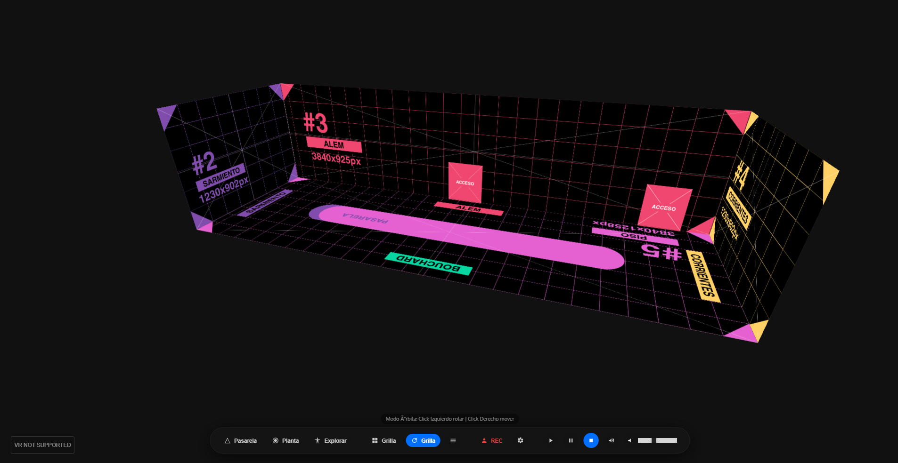
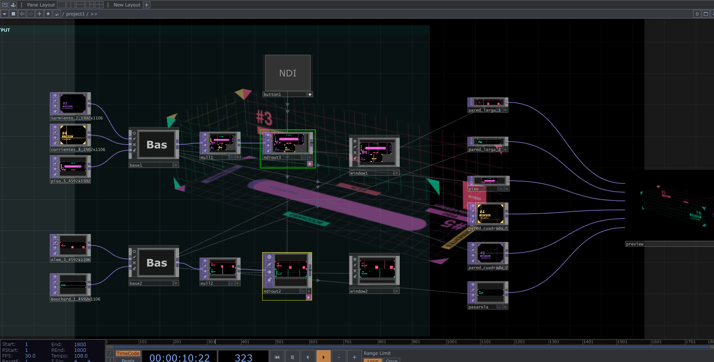

# Sala Inmersiva — Previsualizador (1ª persona + VR)





Web para previsualizar una sala inmersiva desde perspectiva en primera persona, con soporte WebXR/VR, herramientas de mapeo por pared y captura de video. El objetivo es tener un panorama realista de cómo se ven las obras/proyecciones dentro del espacio antes del montaje.

## TouchDesigner (preview realtime)

Además de la versión web, se incluye el proyecto de TouchDesigner `Preview_v1.toe` como alternativa de visualización en tiempo real. Es ideal para previsualizar sistemas realtime complejos o trabajar con archivos de video muy pesados.

## Qué permite hacer

- Recorrer la sala en 1ª persona (desktop con WASD / móvil con joystick).
- Navegar en modo órbita (rotar y desplazar la cámara con el mouse).
- Entrar en VR (WebXR) y moverse/teletransportarse dentro de la sala.
- Cargar un video principal y/o asignar videos individuales por pared y por “slot” (grilla), con soporte para `.mp4`, `.webm` y `.mov` (H.264).
- Lanzar todos los videos y audio en sincronización desde `00:00` con un click desde el panel (**Lanzar Todos en Sincro**) o la barra inferior.
- Optimización automática de rendimiento (**Modo Fluido**) para videos pesados (4K+ o múltiples streams simultáneos), con renderizado condicional por pared.
- Ajustar por pared: repetición (X/Y), rotación, mirror (X/Y), flip (X/Y).
- Guardar y cargar configuraciones de proyecto en JSON.
- Grabar la vista de la cámara (captura del canvas) y descargar el archivo.

## Instalación rápida (Windows — sin requisitos)

Si descargaste el proyecto y querés usarlo con un acceso directo en el Escritorio y Menú Inicio sin instalar Python ni configurar nada:

1. Ejecutá `SalaInmersiva_Setup.exe`.
2. Se instala en `%LOCALAPPDATA%\SalaInmersiva` (no requiere permisos de administrador) y crea el acceso directo **Sala Inmersiva 3D**.
3. Para regenerar el instalador luego de modificar archivos, ejecutá `build_installer.ps1` en PowerShell.

## Instalación y ejecución en macOS

En macOS el equivalente al `.bat` de Windows son los archivos `.command` (doble click):

1. **Instalación completa** (recomendado): ejecutá `instalar_mac.command` (instala en `~/Applications/SalaInmersiva`, crea `Sala Inmersiva 3D.app` en `~/Applications` y un acceso directo en el Escritorio).
2. **Ejecución directa sin instalar**: ejecutá `iniciar_servidor_mac.command` (busca puerto libre `8000`–`8050`, usa `python3` / `python` / `ruby` / `php` y abre el navegador).
3. Si descargaste el `.zip` desde GitHub y macOS no te deja abrirlo con doble click por permisos o Gatekeeper, ejecutá una sola vez en Terminal:
   ```bash
   chmod +x instalar_mac.command iniciar_servidor_mac.command
   ./instalar_mac.command
   ```

## Cómo ejecutar (local)

Este proyecto no requiere build: es un `index.html` con Three.js vía CDN. Para que todo funcione correctamente (video, WebXR, etc.), se recomienda servirlo con un servidor local.

### Opción 1 (Windows — recomendado)

1. Ejecutar `iniciar_servidor.bat`.
2. Busca automáticamente un puerto libre a partir de `8000` (si está ocupado usa `8001`, etc.), espera a que el servidor esté listo y abre el navegador.
3. Usa Python si está instalado (`py -3`, `python`, `python3`), y si no hay Python disponible, levanta automáticamente un servidor HTTP nativo con PowerShell (`assets/server.ps1`). No requiere instalar nada adicional.

### Opción 2 (manual)

```bash
python -m http.server 8000
```

Luego abrir:

- `http://localhost:8000/`

## Controles y atajos

### Modo Órbita (por defecto)

- Click izquierdo: rotar
- Click derecho: mover (pan)

### Modo 1ª persona (Explorar)

- Desktop: WASD para moverse, ESC para salir del modo
- Móvil: joystick izquierdo para moverse, deslizar en el lado derecho para girar

### Atajos de teclado

- `P`: mostrar/ocultar Panel de Control (admin)
- `O`: mostrar/ocultar barra inferior (usuario)

## Barra de usuario (abajo)

Accesos rápidos pensados para uso en sala / revisión rápida:

- **Pasarela**: lleva la cámara a la posición de pasarela.
- **Planta**: vista superior (planta) para inspección general.
- **Explorar**: activa modo 1ª persona.
- **Surface / Couleur**: carga videos predefinidos por URL/nombre de archivo.
- **REC**: inicia/detiene la grabación de la cámara (igual que en el panel).

Nota: los botones **Surface** y **Couleur** apuntan a `surface.mp4` y `couleur.mp4` en la raíz del proyecto. Si no existen o están bloqueados, se puede cargar un video local desde el panel o usar el fallback demo.

## Panel de Control (admin)

El panel se muestra/oculta con `P` y está dividido en 3 pestañas:

### 1) Media & Datos

**Fuente de Video**

- **Cargar Video Local**: permite seleccionar un archivo (`.mp4`, `.webm`, `.mov`) y usarlo como video principal.
- **Volumen**: slider de volumen del video principal (al moverlo, se desmutea).

**Gestión de Proyecto (JSON)**

- **Guardar**: exporta `sala_inmersiva_config.json` con la configuración actual.
- **Cargar**: importa un `.json` previamente exportado.

### 2) Vista & Nav

**Visualización**

- **Pasarela Mode**
  - **Estándar**
  - **Piso Continuo**: aplica la textura del piso a la pasarela para continuidad visual.
  - **Ocultar Pasarela**
- **Mostrar Nombres**: muestra/oculta etiquetas (BOUCHARD, ALEM, SARMIENTO, CORRIENTES).

**Cámara**

- **Modo 1ª Persona (WASD)**: entra en exploración en primera persona.
- **Ir a Pasarela** / **Vista Planta**: atajos de navegación.

**Captura**

- **Grabar Cámara (.mp4)**: inicia/detiene la captura del canvas y descarga el archivo.

### 3) Mapeo UV

**Seleccionar Pared**

- Paredes disponibles en la UI: **PISO**, **BOU** (Bouchard), **ALEM**, **SARM** (Sarmiento), **CORR** (Corrientes).

**Controles por pared**

- **Repetición X / Repetición Y**: define la grilla (cantidad de columnas/filas) usada para componer la textura.
- **Rotación**: 0°, 90°, 180°, 270° (incluye una opción “270° (Exact)” para el piso).
- **Mirror X / Mirror Y**: espejado alternado por celda (tipo damero) en X/Y según el índice de la grilla.
- **Flip X / Flip Y**: invierte la textura completa en X/Y.

**Videos individuales por slot**

- Al cambiar **Repetición X/Y**, se recalculan los slots.
- Para cada slot (Xn, Yn), se puede **Seleccionar** un video distinto.
- Los videos por slot se reproducen en loop y, por defecto, van muteados para no superponer audio.

## VR (WebXR)

- La interfaz agrega un botón **Enter VR** (WebXR) cuando el navegador/dispositivo lo soporta.
- En VR:
  - Teleport: apuntar con el control y mantener selección para marcar; al soltar, se teletransporta.
  - Movimiento: si hay gamepad/sticks, permite desplazamiento suave con los ejes del control.

Importante: en la mayoría de navegadores, WebXR requiere contexto seguro (HTTPS). En local suele funcionar con `localhost`.

## Grabación (captura del canvas)

- La grabación captura la salida renderizada del canvas (no es “screen recording” del navegador).
- Se descarga un archivo generado por `MediaRecorder`. Si tu reproductor no abre el archivo descargado, probá renombrarlo a `.webm` o convertirlo a `.mp4` con una herramienta de conversión.

**Sincronización y Rendimiento (siempre visible en el panel)**

- **Lanzar Todos en Sincro (00:00)**: pausa todos los videos activos y el audio, los resetea a `00:00` y los inicia juntos.
- **Pausar / Stop**: controla todos los videos y el audio sincronizado.
- **Modo Fluido (`Auto` / `Activo` / `Alta Calidad`)**: en `Auto`, si detecta `>= 2` videos activos o resolución `>= 2560px`, reduce la escala de los canvas de pared a la mitad (máx. 1024px) y `pixelRatio = 1` para mantener fluidez.

## Estructura del proyecto

- `index.html`: aplicación web y UI.
- `assets/app.js` y `assets/styles.css`: lógica Three.js/WebXR, mapeo, sincronización y estilos.
- `assets/server.ps1`: servidor HTTP local en PowerShell (fallback sin dependencias para Windows).
- `iniciar_servidor.bat`: detecta puerto libre, levanta el servidor local (Python o PowerShell) y abre el navegador en Windows.
- `iniciar_servidor_mac.command` / `instalar_mac.command`: lanzador e instalador nativo para macOS (doble click).
- `build_installer.ps1` / `SalaInmersiva_Setup.exe`: script de compilación e instalador autocontenido para Windows.
- `pixelmap/`: recursos auxiliares (imágenes de referencia).
- `Preview_v1.toe`: proyecto de TouchDesigner (preview en tiempo real).

